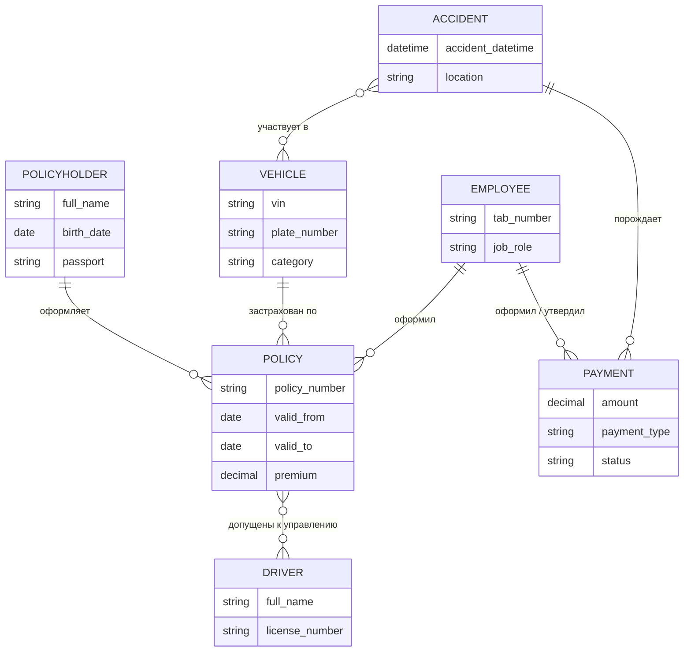

# Практическая работа №2

**Тема:** Основные принципы построения концептуальной, логической и физической модели данных

**Вариант №13. Предметная область: Страховая компания**

**Базовые сущности и процессы:** страхователи, транспортные средства, полисы ОСАГО, ДТП, выплаты.

**Ключевое бизнес-правило и требование безопасности:** период действия полиса ровно 1 год; антифрод-защита суммы возмещения.

---

## 1. Цель работы

Освоить трёхзвенную методологию проектирования реляционных баз данных (концептуальный, логический и физический уровни) на примере страховой компании: построить ER-диаграмму, нормализовать отношения, назначить типы данных и ограничения целостности, реализовать базовые механизмы защиты на уровне СУБД (PostgreSQL).

---

## 2. Концептуальный уровень

### 2.1. Сущности предметной области

- `Страхователь` (Policyholder) — физическое лицо, оформляющее полис ОСАГО;
- `Транспортное средство` (Vehicle) — застрахованный автомобиль;
- `Водитель` (Driver) — лицо, допущенное к управлению по полису или участвующее в ДТП;
- `Полис ОСАГО` (Policy) — договор страхования сроком ровно на 1 год;
- `ДТП` (Accident) — страховой случай;
- `Выплата` (Payment) — возмещение, выплачиваемое потерпевшему;
- `Сотрудник` (Employee) — агент, специалист по урегулированию, сотрудник антифрода, аудитор.

### 2.2. Связи и кардинальности

| Связь | Мощность | Комментарий |
| --- | --- | --- |
| `Страхователь` — `Полис` | 1:N | один страхователь может иметь много полисов |
| `Транспортное средство` — `Полис` | 1:N | на одну машину в разные годы оформляются разные полисы |
| `Сотрудник` — `Полис` | 1:N | сотрудник (агент) оформляет много полисов |
| `Полис` — `Водитель` | M:N | в полис вписывается список допущенных водителей, водитель может быть вписан в несколько полисов |
| `ДТП` — `Транспортное средство` | M:N | в ДТП участвуют несколько машин, машина может попасть в несколько ДТП (в связи есть роль: виновник / потерпевший) |
| `ДТП` — `Выплата` | 1:N | по одному ДТП может быть несколько выплат (разным потерпевшим, за имущество и за здоровье) |
| `Сотрудник` — `Выплата` | 1:N | сотрудник оформляет и утверждает выплаты |

### 2.3. ER-диаграмма (нотация Crow's Foot)



---

## 3. Логический уровень

### 3.1. Разрешение связей M:N

- `Полис` M:N `Водитель` → ассоциативная сущность **Policy_Drivers** (составной ключ `policy_id + driver_id`).
- `ДТП` M:N `Транспортное средство` → ассоциативная сущность **Accident_Participations** (участие в ДТП). В ней хранятся атрибуты связи: водитель за рулём, полис (если был), роль участника (`виновник` / `потерпевший`).
- Связь `Выплата` → ДТП уточняется: выплата привязывается к конкретному **участию потерпевшего** (`victim_participation_id`). Тем самым однозначно известны ДТП, потерпевший и (через участие виновника) полис, по которому платит страховая. Полис виновника в таблице выплат не дублируется — это сохраняет 3НФ.

### 3.2. Логическая схема отношений

1. **Employees** (Сотрудники)
   - `employee_id` (PK, суррогатный);
   - `tab_number` (UNIQUE, NOT NULL) — табельный номер, естественный ключ;
   - `full_name` (NOT NULL);
   - `job_role` (NOT NULL, CHECK IN `агент`, `урегулирование`, `антифрод`, `аудитор`).

2. **Policyholders** (Страхователи)
   - `policyholder_id` (PK);
   - `last_name`, `first_name` (NOT NULL), `middle_name` (NULL);
   - `birth_date` (NOT NULL, CHECK — страхователю не менее 18 лет);
   - `passport_hash` (UNIQUE, NOT NULL) — хэш паспорта для поиска и контроля дублей;
   - `passport_encrypted` (NOT NULL) — зашифрованные паспортные данные;
   - `phone_encrypted` (NOT NULL);
   - `email` (NULL).

3. **Vehicles** (Транспортные средства)
   - `vehicle_id` (PK);
   - `vin` (UNIQUE, NOT NULL), `plate_number` (UNIQUE, NOT NULL) — естественные ключи-кандидаты;
   - `brand`, `model` (NOT NULL);
   - `manufacture_year` (CHECK ≥ 1980 и не позже текущего года);
   - `category` (CHECK IN `A`, `B`, `C`, `D`);
   - `engine_power_hp` (CHECK > 0).

4. **Drivers** (Водители)
   - `driver_id` (PK);
   - `last_name`, `first_name` (NOT NULL), `middle_name` (NULL);
   - `birth_date` (NOT NULL);
   - `license_hash` (UNIQUE, NOT NULL), `license_encrypted` (NOT NULL) — номер водительского удостоверения;
   - `license_issue_date` (NOT NULL, CHECK > `birth_date`).

5. **Policies** (Полисы ОСАГО)
   - `policy_id` (PK);
   - `policy_number` (UNIQUE, NOT NULL);
   - `policyholder_id` (FK → Policyholders, NOT NULL);
   - `vehicle_id` (FK → Vehicles, NOT NULL);
   - `agent_id` (FK → Employees, NOT NULL);
   - `valid_from` (DATE, NOT NULL), `valid_to` (DATE, NOT NULL);
   - `unlimited_drivers` (BOOLEAN, NOT NULL) — полис без ограничения списка водителей;
   - `kbm` (коэффициент бонус-малус, CHECK в тарифном коридоре);
   - `premium_rub` (CHECK > 0);
   - `status` (CHECK IN `действует`, `расторгнут`, `истёк`);
   - **бизнес-правило:** `valid_to = valid_from + 1 год − 1 день` (срок ровно 1 год);
   - **бизнес-правило:** у одной машины не может быть двух пересекающихся по датам действующих полисов.

6. **Policy_Drivers** (Допущенные к управлению)
   - `policy_id` (FK → Policies), `driver_id` (FK → Drivers);
   - PK (`policy_id`, `driver_id`).

7. **Accidents** (ДТП)
   - `accident_id` (PK);
   - `accident_datetime` (NOT NULL, не позже текущего момента);
   - `location_lat`, `location_lon` (NOT NULL, CHECK по диапазонам координат);
   - `address` (NULL);
   - `is_europrotocol` (BOOLEAN, NOT NULL) — оформление без ГИБДД;
   - `police_ref` (NULL) — номер справки/протокола;
   - `description` (NULL);
   - `registered_at` (NOT NULL, ≥ `accident_datetime`).

8. **Accident_Participations** (Участие в ДТП)
   - `participation_id` (PK);
   - `accident_id` (FK → Accidents), `vehicle_id` (FK → Vehicles), `driver_id` (FK → Drivers);
   - `policy_id` (FK → Policies, NULL — у участника мог не быть полиса);
   - `role` (NOT NULL, CHECK IN `виновник`, `потерпевший`);
   - UNIQUE (`accident_id`, `vehicle_id`) — машина не может участвовать в одном ДТП дважды;
   - в одном ДТП ровно один виновник (частичный уникальный индекс).

9. **Payments** (Выплаты)
   - `payment_id` (PK);
   - `victim_participation_id` (FK → Accident_Participations, NOT NULL);
   - `payment_type` (CHECK IN `имущество`, `здоровье`);
   - `amount_rub` (CHECK > 0 и не выше лимита: 400 000 за имущество, 500 000 за вред здоровью на каждого потерпевшего);
   - `status` (CHECK IN `заявлена`, `на проверке антифрод`, `одобрена`, `выплачена`, `отклонена`);
   - `fraud_score` (0–100) — оценка риска мошенничества;
   - `created_by` (FK → Employees, NOT NULL), `approved_by` (FK → Employees, NULL);
   - правило «четырёх глаз»: `approved_by ≠ created_by`; в статусы `одобрена` и `выплачена` выплата переходит только при наличии утверждающего и `fraud_score` < 70.

10. **Payment_Audit** (Журнал изменений выплат — служебная таблица, без внешних ключей, чтобы журнал сохранялся даже при удалении записи).

### 3.3. Проверка нормальных форм

- **1НФ:** все атрибуты атомарны (ФИО разбито на фамилию, имя, отчество; координаты — на широту и долготу); повторяющиеся группы вынесены в отдельные таблицы (список водителей — `Policy_Drivers`, участники ДТП — `Accident_Participations`).
- **2НФ:** во всех таблицах с составным ключом (`Policy_Drivers`) нет неключевых атрибутов; в остальных таблицах ключ простой (суррогатный), поэтому частичных зависимостей быть не может.
- **3НФ:** транзитивных зависимостей нет: данные о машине хранятся только в `Vehicles`, данные о страхователе — в `Policyholders`, ФИО сотрудника — в `Employees`; в `Payments` не дублируются ДТП и полис виновника (они определяются через `victim_participation_id`). Размер премии и КБМ сохраняются в полисе как зафиксированные на дату заключения условия договора (тарифы меняются), а не как вычисляемое значение, поэтому нормализацию это не нарушает.

---

## 4. Физический уровень (PostgreSQL)

### 4.1. Выбор типов данных

| Поле | Тип | Обоснование |
| --- | --- | --- |
| Суррогатные ключи справочных таблиц | `SERIAL` / `INT` (4 байта) | до ~2 млрд записей — с запасом |
| Ключи `accidents`, `participations`, `payments`, `policies` | `BIGSERIAL` / `BIGINT` | таблицы быстро растут, исключаем переполнение |
| `vin` | `CHAR(17)` | стандартная фиксированная длина |
| `plate_number` | `VARCHAR(9)` | до 9 символов с кодом региона |
| `policy_number` | `VARCHAR(15)` | серия + номер полиса |
| `category`, `role`, `status` | `VARCHAR` + `CHECK` | короткие справочные значения без отдельной таблицы |
| `manufacture_year`, `engine_power_hp`, `fraud_score` | `SMALLINT` (2 байта) | малый диапазон значений |
| `kbm` | `NUMERIC(3,2)` | точное значение коэффициента |
| Деньги (`premium_rub`, `amount_rub`) | `NUMERIC(10,2)` | точная арифметика, `FLOAT` для денег недопустим |
| Даты действия полиса | `DATE` | время суток не нужно, 4 байта |
| Момент ДТП, технические метки | `TIMESTAMPTZ` | учёт часового пояса |
| Широта / долгота | `NUMERIC(9,6)` | точность около 0,1 м |
| Паспорт, телефон, номер ВУ | `BYTEA` (шифрованное значение) + `CHAR(64)` для хэша | защита ПДн (152-ФЗ) |
| Флаги | `BOOLEAN` (1 байт) | |

### 4.2. DDL-скрипт создания схемы

```sql
-- Расширения: шифрование (pgcrypto) и составные исключения (btree_gist)
CREATE EXTENSION IF NOT EXISTS pgcrypto;
CREATE EXTENSION IF NOT EXISTS btree_gist;

CREATE SCHEMA IF NOT EXISTS insurance;
SET search_path TO insurance, public;

-- 1. Сотрудники
CREATE TABLE employees (
    employee_id SERIAL PRIMARY KEY,
    tab_number  VARCHAR(15)  NOT NULL UNIQUE,
    full_name   VARCHAR(150) NOT NULL,
    job_role    VARCHAR(20)  NOT NULL
        CHECK (job_role IN ('агент', 'урегулирование', 'антифрод', 'аудитор'))
);

-- 2. Страхователи
CREATE TABLE policyholders (
    policyholder_id    SERIAL PRIMARY KEY,
    last_name          VARCHAR(60) NOT NULL,
    first_name         VARCHAR(60) NOT NULL,
    middle_name        VARCHAR(60),
    birth_date         DATE NOT NULL
        CHECK (birth_date <= CURRENT_DATE - INTERVAL '18 years'),
    passport_hash      CHAR(64) NOT NULL UNIQUE,   -- SHA-256 (с «перцем»)
    passport_encrypted BYTEA    NOT NULL,          -- pgp_sym_encrypt
    phone_encrypted    BYTEA    NOT NULL,
    email              VARCHAR(100),
    created_at         TIMESTAMPTZ NOT NULL DEFAULT CURRENT_TIMESTAMP
);

-- 3. Транспортные средства
CREATE TABLE vehicles (
    vehicle_id       SERIAL PRIMARY KEY,
    vin              CHAR(17)    NOT NULL UNIQUE,
    plate_number     VARCHAR(9)  NOT NULL UNIQUE,
    brand            VARCHAR(30) NOT NULL,
    model            VARCHAR(40) NOT NULL,
    manufacture_year SMALLINT    NOT NULL
        CHECK (manufacture_year BETWEEN 1980 AND 2100),
    category         CHAR(1)     NOT NULL CHECK (category IN ('A', 'B', 'C', 'D')),
    engine_power_hp  SMALLINT    NOT NULL CHECK (engine_power_hp > 0)
);

-- 4. Водители
CREATE TABLE drivers (
    driver_id          SERIAL PRIMARY KEY,
    last_name          VARCHAR(60) NOT NULL,
    first_name         VARCHAR(60) NOT NULL,
    middle_name        VARCHAR(60),
    birth_date         DATE NOT NULL,
    license_hash       CHAR(64) NOT NULL UNIQUE,
    license_encrypted  BYTEA    NOT NULL,
    license_issue_date DATE     NOT NULL,
    CONSTRAINT chk_license_after_birth CHECK (license_issue_date > birth_date)
);

-- 5. Полисы ОСАГО
CREATE TABLE policies (
    policy_id         BIGSERIAL PRIMARY KEY,
    policy_number     VARCHAR(15) NOT NULL UNIQUE,
    policyholder_id   INT NOT NULL,
    vehicle_id        INT NOT NULL,
    agent_id          INT NOT NULL,
    valid_from        DATE NOT NULL,
    valid_to          DATE NOT NULL,
    unlimited_drivers BOOLEAN NOT NULL DEFAULT FALSE,
    kbm               NUMERIC(3,2) NOT NULL CHECK (kbm BETWEEN 0.46 AND 3.92),
    premium_rub       NUMERIC(10,2) NOT NULL CHECK (premium_rub > 0),
    status            VARCHAR(15) NOT NULL DEFAULT 'действует'
        CHECK (status IN ('действует', 'расторгнут', 'истёк')),
    CONSTRAINT fk_policies_holder  FOREIGN KEY (policyholder_id)
        REFERENCES policyholders (policyholder_id) ON DELETE RESTRICT ON UPDATE CASCADE,
    CONSTRAINT fk_policies_vehicle FOREIGN KEY (vehicle_id)
        REFERENCES vehicles (vehicle_id) ON DELETE RESTRICT ON UPDATE CASCADE,
    CONSTRAINT fk_policies_agent   FOREIGN KEY (agent_id)
        REFERENCES employees (employee_id) ON DELETE RESTRICT ON UPDATE CASCADE,
    -- Ключевое бизнес-правило: срок действия полиса ровно 1 год
    CONSTRAINT chk_policy_one_year
        CHECK (valid_to = (valid_from + INTERVAL '1 year' - INTERVAL '1 day')::date),
    -- У одной машины не может быть пересекающихся действующих полисов
    CONSTRAINT ex_policy_no_overlap
        EXCLUDE USING gist (
            vehicle_id WITH =,
            daterange(valid_from, valid_to, '[]') WITH &&
        ) WHERE (status <> 'расторгнут')
);

-- 6. Допущенные к управлению (ассоциативная таблица M:N)
CREATE TABLE policy_drivers (
    policy_id BIGINT NOT NULL REFERENCES policies (policy_id) ON DELETE CASCADE,
    driver_id INT    NOT NULL REFERENCES drivers (driver_id)  ON DELETE RESTRICT,
    PRIMARY KEY (policy_id, driver_id)
);

-- 7. ДТП
CREATE TABLE accidents (
    accident_id       BIGSERIAL PRIMARY KEY,
    accident_datetime TIMESTAMPTZ NOT NULL
        CHECK (accident_datetime <= CURRENT_TIMESTAMP),
    location_lat      NUMERIC(9,6) NOT NULL CHECK (location_lat BETWEEN -90 AND 90),
    location_lon      NUMERIC(9,6) NOT NULL CHECK (location_lon BETWEEN -180 AND 180),
    address           VARCHAR(200),
    is_europrotocol   BOOLEAN NOT NULL DEFAULT FALSE,
    police_ref        VARCHAR(30),
    description       TEXT,
    registered_at     TIMESTAMPTZ NOT NULL DEFAULT CURRENT_TIMESTAMP,
    CONSTRAINT chk_registered_after_accident CHECK (registered_at >= accident_datetime)
);

-- 8. Участие в ДТП (ассоциативная таблица M:N с атрибутами)
CREATE TABLE accident_participations (
    participation_id BIGSERIAL PRIMARY KEY,
    accident_id      BIGINT NOT NULL REFERENCES accidents (accident_id) ON DELETE CASCADE,
    vehicle_id       INT    NOT NULL REFERENCES vehicles (vehicle_id)   ON DELETE RESTRICT,
    driver_id        INT    NOT NULL REFERENCES drivers (driver_id)     ON DELETE RESTRICT,
    policy_id        BIGINT REFERENCES policies (policy_id) ON DELETE RESTRICT,
    role             VARCHAR(12) NOT NULL CHECK (role IN ('виновник', 'потерпевший')),
    CONSTRAINT uq_accident_vehicle UNIQUE (accident_id, vehicle_id)
);

-- В одном ДТП ровно один виновник
CREATE UNIQUE INDEX uq_one_culprit
    ON accident_participations (accident_id) WHERE role = 'виновник';

-- 9. Выплаты
CREATE TABLE payments (
    payment_id              BIGSERIAL PRIMARY KEY,
    victim_participation_id BIGINT NOT NULL
        REFERENCES accident_participations (participation_id) ON DELETE RESTRICT,
    payment_type            VARCHAR(10) NOT NULL
        CHECK (payment_type IN ('имущество', 'здоровье')),
    amount_rub              NUMERIC(10,2) NOT NULL CHECK (amount_rub > 0),
    status                  VARCHAR(25) NOT NULL DEFAULT 'заявлена'
        CHECK (status IN ('заявлена', 'на проверке антифрод', 'одобрена',
                          'выплачена', 'отклонена')),
    fraud_score             SMALLINT NOT NULL DEFAULT 0
        CHECK (fraud_score BETWEEN 0 AND 100),
    created_by              INT NOT NULL REFERENCES employees (employee_id) ON DELETE RESTRICT,
    approved_by             INT REFERENCES employees (employee_id) ON DELETE RESTRICT,
    created_at              TIMESTAMPTZ NOT NULL DEFAULT CURRENT_TIMESTAMP,
    paid_at                 TIMESTAMPTZ,
    -- Антифрод 1: лимиты возмещения по ОСАГО на каждого потерпевшего
    CONSTRAINT chk_payment_limit CHECK (
        amount_rub <= CASE payment_type WHEN 'имущество' THEN 400000 ELSE 500000 END
    ),
    -- Антифрод 2: «четыре глаза» и порог риска для одобрения/выплаты
    CONSTRAINT chk_payment_approval CHECK (
        status NOT IN ('одобрена', 'выплачена')
        OR (approved_by IS NOT NULL AND approved_by <> created_by AND fraud_score < 70)
    ),
    CONSTRAINT chk_paid_at CHECK (paid_at IS NULL OR status = 'выплачена')
);

-- 10. Журнал аудита выплат (без FK, чтобы журнал пережил удаление записи)
CREATE TABLE payment_audit (
    audit_id   BIGSERIAL PRIMARY KEY,
    payment_id BIGINT NOT NULL,
    action     CHAR(1) NOT NULL CHECK (action IN ('I', 'U', 'D')),
    old_amount NUMERIC(10,2),
    new_amount NUMERIC(10,2),
    old_status VARCHAR(25),
    new_status VARCHAR(25),
    changed_by TEXT        NOT NULL DEFAULT session_user,
    client_ip  INET        DEFAULT inet_client_addr(),
    changed_at TIMESTAMPTZ NOT NULL DEFAULT CURRENT_TIMESTAMP
);
```

### 4.3. Триггеры: антифрод-контроль суммы возмещения и аудит

```sql
-- Проверка выплаты: роль потерпевшего, действие полиса виновника на дату ДТП,
-- совокупный лимит по потерпевшему, автоматическая отправка крупных сумм на антифрод
CREATE OR REPLACE FUNCTION fn_check_payment() RETURNS trigger
LANGUAGE plpgsql AS $$
DECLARE
    v_accident_id BIGINT;
    v_role        VARCHAR(12);
    v_acc_date    DATE;
    v_valid_from  DATE;
    v_valid_to    DATE;
    v_limit       NUMERIC(10,2);
    v_already     NUMERIC(12,2);
BEGIN
    SELECT ap.accident_id, ap.role
      INTO v_accident_id, v_role
      FROM accident_participations ap
     WHERE ap.participation_id = NEW.victim_participation_id;

    IF v_role IS DISTINCT FROM 'потерпевший' THEN
        RAISE EXCEPTION 'Выплата возможна только потерпевшему участнику ДТП';
    END IF;

    SELECT (a.accident_datetime AT TIME ZONE 'Europe/Moscow')::date
      INTO v_acc_date
      FROM accidents a
     WHERE a.accident_id = v_accident_id;

    -- Полис виновника
    SELECT p.valid_from, p.valid_to
      INTO v_valid_from, v_valid_to
      FROM accident_participations c
      JOIN policies p ON p.policy_id = c.policy_id
     WHERE c.accident_id = v_accident_id AND c.role = 'виновник';

    IF NOT FOUND THEN
        RAISE EXCEPTION 'У виновника ДТП нет полиса ОСАГО: выплата невозможна';
    END IF;

    IF v_acc_date NOT BETWEEN v_valid_from AND v_valid_to THEN
        RAISE EXCEPTION 'ДТП произошло вне срока действия полиса виновника';
    END IF;

    -- Совокупный лимит по потерпевшему и виду вреда
    v_limit := CASE NEW.payment_type WHEN 'имущество' THEN 400000 ELSE 500000 END;

    SELECT COALESCE(SUM(amount_rub), 0)
      INTO v_already
      FROM payments
     WHERE victim_participation_id = NEW.victim_participation_id
       AND payment_type = NEW.payment_type
       AND status <> 'отклонена'
       AND payment_id <> NEW.payment_id;

    IF v_already + NEW.amount_rub > v_limit THEN
        RAISE EXCEPTION 'Превышен лимит возмещения: % руб.', v_limit;
    END IF;

    -- Крупные суммы автоматически отправляются на проверку антифрод
    IF NEW.status = 'заявлена' AND NEW.amount_rub >= 200000 THEN
        NEW.status := 'на проверке антифрод';
    END IF;

    RETURN NEW;
END;
$$;

CREATE TRIGGER trg_check_payment
    BEFORE INSERT OR UPDATE OF amount_rub, payment_type, victim_participation_id
    ON payments
    FOR EACH ROW EXECUTE FUNCTION fn_check_payment();

-- Аудит: фиксация всех вставок, изменений и удалений выплат
CREATE OR REPLACE FUNCTION fn_audit_payment() RETURNS trigger
LANGUAGE plpgsql SECURITY DEFINER SET search_path = insurance, public AS $$
BEGIN
    IF TG_OP = 'INSERT' THEN
        INSERT INTO payment_audit (payment_id, action, new_amount, new_status)
        VALUES (NEW.payment_id, 'I', NEW.amount_rub, NEW.status);
        RETURN NEW;
    ELSIF TG_OP = 'UPDATE' THEN
        INSERT INTO payment_audit (payment_id, action, old_amount, new_amount,
                                   old_status, new_status)
        VALUES (NEW.payment_id, 'U', OLD.amount_rub, NEW.amount_rub,
                OLD.status, NEW.status);
        RETURN NEW;
    ELSE
        INSERT INTO payment_audit (payment_id, action, old_amount, old_status)
        VALUES (OLD.payment_id, 'D', OLD.amount_rub, OLD.status);
        RETURN OLD;
    END IF;
END;
$$;

CREATE TRIGGER trg_payment_audit
    AFTER INSERT OR UPDATE OR DELETE ON payments
    FOR EACH ROW EXECUTE FUNCTION fn_audit_payment();
```

### 4.4. Политика индексирования

```sql
-- Индексы на внешние ключи (ускорение JOIN и контроль ссылочной целостности)
CREATE INDEX idx_policies_holder        ON policies (policyholder_id);
CREATE INDEX idx_policies_vehicle       ON policies (vehicle_id);
CREATE INDEX idx_policies_agent         ON policies (agent_id);
CREATE INDEX idx_policy_drivers_driver  ON policy_drivers (driver_id);
CREATE INDEX idx_participations_acc     ON accident_participations (accident_id);
CREATE INDEX idx_participations_vehicle ON accident_participations (vehicle_id);
CREATE INDEX idx_participations_policy  ON accident_participations (policy_id);
CREATE INDEX idx_payments_victim        ON payments (victim_participation_id);
CREATE INDEX idx_payments_created_by    ON payments (created_by);

-- Частые фильтры
CREATE INDEX idx_policies_active_end ON policies (valid_to) WHERE status = 'действует';
CREATE INDEX idx_accidents_datetime  ON accidents (accident_datetime);
CREATE INDEX idx_payments_antifraud  ON payments (created_at) WHERE status = 'на проверке антифрод';

-- Антифрод-аналитика: частота ДТП по автомобилю и водителю
CREATE INDEX idx_participations_vehicle_acc ON accident_participations (vehicle_id, accident_id);
CREATE INDEX idx_participations_driver      ON accident_participations (driver_id);

-- Просмотр истории изменений выплаты
CREATE INDEX idx_audit_payment ON payment_audit (payment_id, changed_at);
```

Индексы по `UNIQUE`-полям (`policy_number`, `vin`, `plate_number`, `passport_hash`, `license_hash`, `tab_number`) PostgreSQL создаёт автоматически. Индексы по `PRIMARY KEY` также создаются автоматически.

### 4.5. Безопасность на физическом уровне

#### Шифрование персональных данных

```sql
-- Пример вставки страхователя: паспорт и телефон хранятся только в зашифрованном виде.
-- Ключ шифрования передаётся приложением на время сессии и в БД не хранится.
INSERT INTO policyholders
    (last_name, first_name, birth_date, passport_hash, passport_encrypted, phone_encrypted)
VALUES (
    'Иванов', 'Пётр', DATE '1990-05-14',
    encode(digest('4510123456' || current_setting('app.pepper'), 'sha256'), 'hex'),
    pgp_sym_encrypt('4510123456', current_setting('app.enc_key')),
    pgp_sym_encrypt('+79990001122', current_setting('app.enc_key'))
);
```

Хэш паспорта (с секретным «перцем») нужен для поиска и контроля дублей без расшифровки. Пересылка данных между клиентом и сервером защищается TLS (`ssl = on`).

#### Ролевой доступ (RBAC)

```sql
CREATE ROLE agent_role;       -- страховой агент
CREATE ROLE adjuster_role;    -- специалист по урегулированию убытков
CREATE ROLE antifraud_role;   -- сотрудник антифрода
CREATE ROLE auditor_role;     -- аудитор / служба безопасности
CREATE ROLE analyst_role;     -- аналитик (только обезличенные данные)

GRANT USAGE ON SCHEMA insurance TO agent_role, adjuster_role,
                                   antifraud_role, auditor_role, analyst_role;

-- Агент: оформление полисов, но не выплаты и не ДТП
GRANT SELECT, INSERT, UPDATE ON policyholders, vehicles, drivers,
                                policies, policy_drivers TO agent_role;
GRANT SELECT ON employees TO agent_role;

-- Специалист по урегулированию: регистрация ДТП и подготовка выплат
GRANT SELECT ON policyholders, vehicles, drivers, policies,
                policy_drivers, employees TO adjuster_role;
GRANT SELECT, INSERT, UPDATE ON accidents, accident_participations TO adjuster_role;
GRANT SELECT, INSERT ON payments TO adjuster_role;

-- Антифрод: чтение всего контура ДТП/выплат, право менять только оценку и статус
GRANT SELECT ON accidents, accident_participations, policies,
                vehicles, drivers, payments TO antifraud_role;
GRANT UPDATE (fraud_score, status, approved_by, paid_at) ON payments TO antifraud_role;

-- Аудитор: только журнал и чтение выплат
GRANT SELECT ON payment_audit, payments TO auditor_role;

GRANT USAGE, SELECT ON ALL SEQUENCES IN SCHEMA insurance
    TO agent_role, adjuster_role;

-- Удаление выплат запрещено всем, журнал аудита недоступен для изменения
REVOKE DELETE ON payments FROM PUBLIC, agent_role, adjuster_role, antifraud_role;
REVOKE ALL ON payment_audit FROM PUBLIC;
GRANT SELECT ON payment_audit TO auditor_role;

-- Маскированное представление для аналитиков: без ФИО, паспорта и телефона
CREATE VIEW v_policyholders_masked AS
SELECT policyholder_id,
       LEFT(last_name, 1) || '***' AS last_name_masked,
       EXTRACT(YEAR FROM birth_date)::INT AS birth_year
FROM policyholders;

GRANT SELECT ON v_policyholders_masked, vehicles, policies,
                accidents, accident_participations TO analyst_role;
```

Прямой доступ аналитиков к таблицам `policyholders`, `drivers` и `payment_audit` не выдаётся: чувствительные столбцы защищены и шифрованием, и маскированием.

---

## 5. Сводная таблица архитектурных уровней модели

| Параметр сравнения | Концептуальная модель | Логическая модель | Физическая модель |
| --- | --- | --- | --- |
| **Целевая аудитория** | Руководство страховой компании, бизнес-аналитики, андеррайтеры | Системные аналитики, архитекторы данных | Администраторы БД (DBA), backend-разработчики |
| **Степень абстракции** | Максимальная: 7 сущностей и смысловые связи (страхователь, ТС, полис, ДТП, выплата) | Средняя: 10 таблиц, PK/FK, нормализация до 3НФ, ассоциативные таблицы | Минимальная: PostgreSQL, типы данных, DDL, индексы, триггеры |
| **Инструментарий** | ER-диаграмма Crow's Foot | Реляционные схемы, проверка 1НФ–3НФ | SQL DDL, `EXPLAIN`, `CREATE INDEX`, `GRANT` |
| **Независимость** | Не зависит от СУБД | Не зависит от конкретной СУБД | Привязана к PostgreSQL (`pgcrypto`, `btree_gist`, `EXCLUDE`) |
| **Бизнес-правила** | Описаны словесно: срок полиса 1 год, лимиты выплат | Формализованы как ограничения (CHECK, UNIQUE, NOT NULL) | Реализованы в СУБД: `CHECK`, `EXCLUDE`, триггеры |
| **Реализация безопасности** | Определена критичность данных (паспорт, выплаты) и субъекты доступа | Спроектированы ограничения целостности и правило «четырёх глаз» | Роли RBAC, шифрование `pgcrypto`, маскирование, TLS, журнал аудита |

---

## 6. Выводы

В работе для предметной области «Страховая компания» последовательно построены три уровня модели данных. На концептуальном уровне выделены 7 сущностей и связи 1:N и M:N. На логическом уровне связи M:N разрешены ассоциативными таблицами `Policy_Drivers` и `Accident_Participations`, структура приведена к 3НФ. На физическом уровне составлен DDL-скрипт для PostgreSQL, в котором ключевое бизнес-правило (срок действия полиса ровно 1 год) реализовано ограничением `CHECK`, а запрет пересекающихся полисов — ограничением `EXCLUDE`. Антифрод-защита суммы возмещения обеспечена тремя механизмами: лимитами выплат (`CHECK` и триггер совокупного лимита), правилом «четырёх глаз» с порогом риска `fraud_score` и неизменяемым журналом аудита. Персональные данные защищены шифрованием (`pgcrypto`), ролевым доступом (RBAC) и маскированным представлением для аналитиков.
